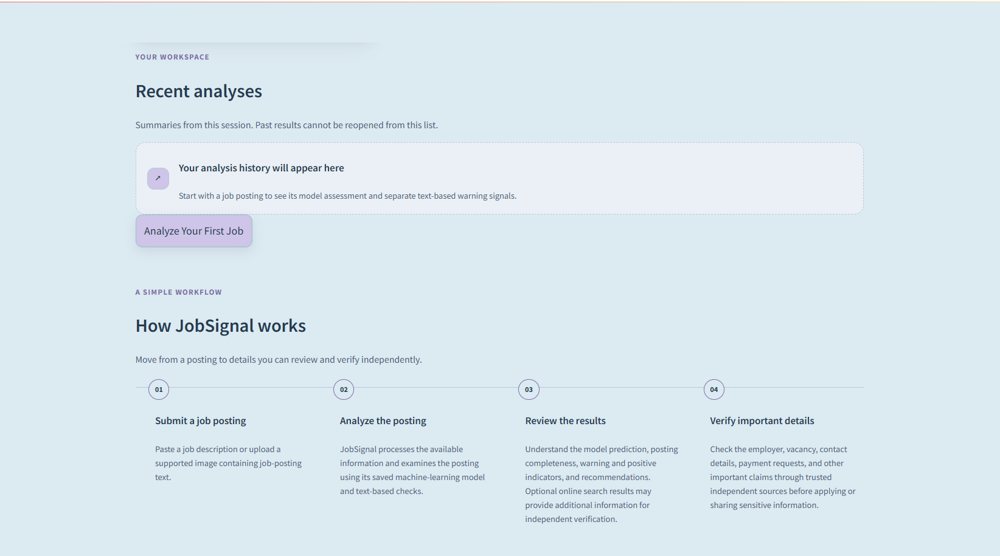
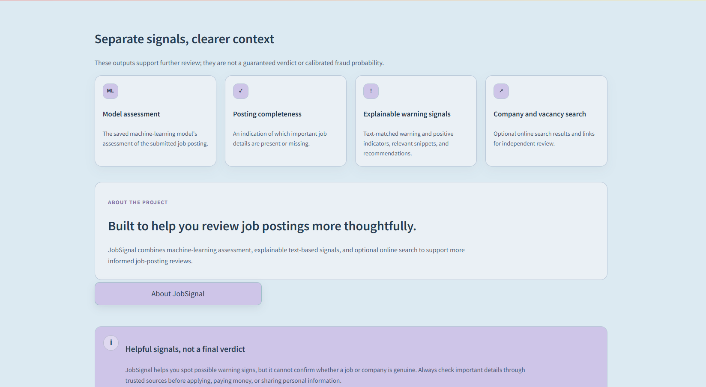
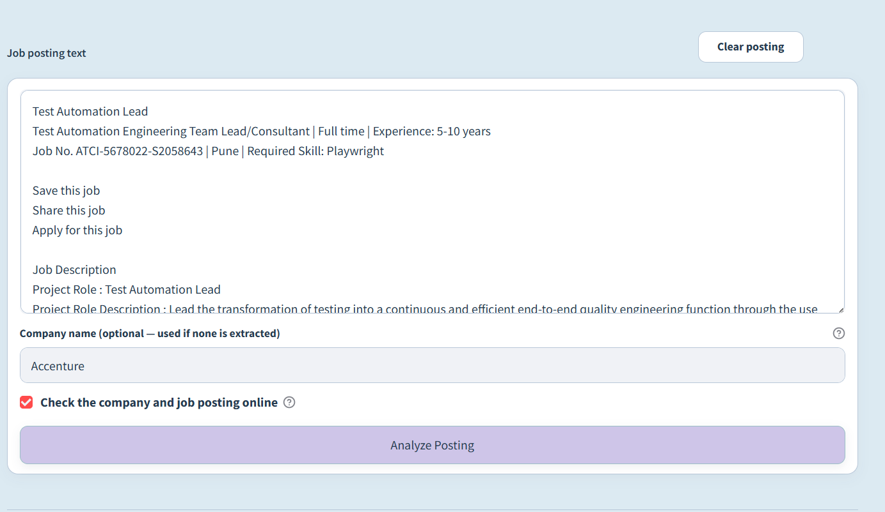
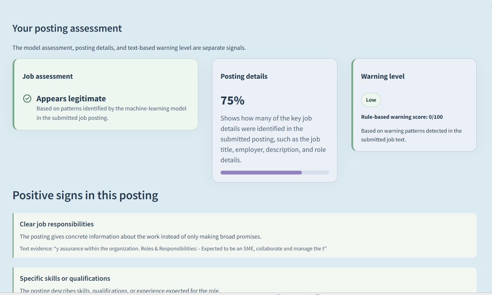
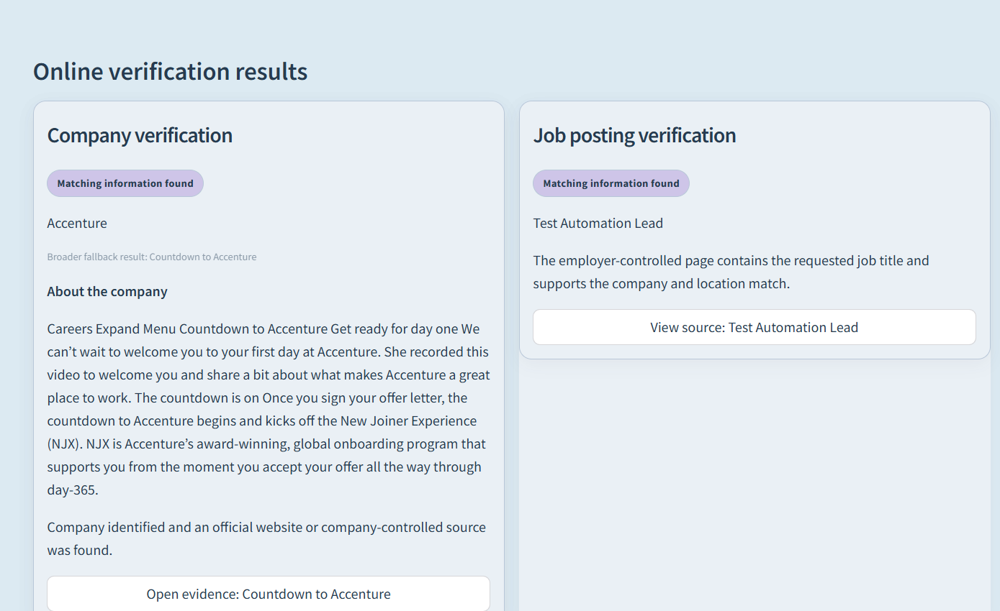
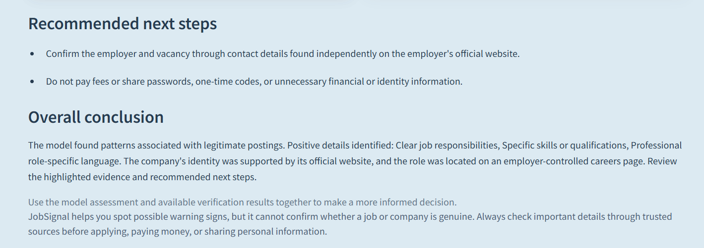

# Job Signal

## Table of contents

- [A. Project title and introduction](#a-project-title-and-introduction)
- [B. Project objectives](#b-project-objectives)
- [Dataset Information](#dataset-information)
- [C. Application workflow](#c-application-workflow)
- [D. Main features](#d-main-features)
- [Application Screenshots](#application-screenshots)
- [E. Technology stack](#e-technology-stack)
- [F. Repository structure](#f-repository-structure)
- [G. Installation and setup](#g-installation-and-setup)
- [H. Tavily API configuration](#h-tavily-api-configuration)
- [I. Model and preprocessing artifacts](#i-model-and-preprocessing-artifacts)
- [Model Evaluation Results](#model-evaluation-results)
- [J. Testing and validation](#j-testing-and-validation)
- [K. Limitations and responsible use](#k-limitations-and-responsible-use)
- [L. Future improvements](#l-future-improvements)
- [M. Deployment on Streamlit Community Cloud](#m-deployment-on-streamlit-community-cloud)
- [N. Deployment configuration and secrets](#n-deployment-configuration-and-secrets)
- [O. Authentication](#o-authentication)
- [P. Company and vacancy verification](#p-company-and-vacancy-verification)
- [Q. GitHub update and deployment workflow](#q-github-update-and-deployment-workflow)
- [R. Project status](#r-project-status)
- [Contributors and Acknowledgements](#contributors-and-acknowledgements)
- [References](#references)

## A. Project title and introduction

**Academic project title:** Fake Job Posting Detection Using Machine Learning
and Explainable Artificial Intelligence.

Fraudulent online job postings can mislead applicants, solicit fees, or request
personal information under false pretenses. Job Signal is a Streamlit
decision-support application for job seekers, students, recent graduates, and
other applicants who want to review a posting before taking action. It
combines a saved machine-learning prediction with separate text-based
indicators, image text extraction, and optional company and vacancy searches.

## B. Project objectives

- Identify postings that the saved machine-learning model classifies as
  potentially fraudulent.
- Analyze pasted job-posting text and extract commonly used job fields.
- Support image-based analysis by extracting text from an uploaded posting.
- Present text evidence and rule-based explanations alongside the model result.
  These rules do not explain the Linear SVM's internal reasoning or change its
  prediction.
- Offer optional searches for company and vacancy information.
- Show warning indicators and safety recommendations without presenting them
  as proof or a guarantee.

## Dataset Information

The project references the **Real & Fake Jobs Posting Prediction** dataset on
[Kaggle](https://www.kaggle.com/datasets/rishantenis/real-and-fake-jobs-posting-prediction)
([Reference 4](#references)). The Kaggle listing describes approximately
**18,000 job descriptions**, of which approximately **800 are labeled fake**.
These are rounded figures from the listing, not a verified count of records
used to train or evaluate this project's model.

The original Employment Scam Aegean Dataset (**EMSCAD**) research reports
**17,880 annotated job postings** published between 2012 and 2014: **17,014
legitimate** and **866 fraudulent** ([Vidros et al., 2017; Reference 1](#references)).
These original EMSCAD statistics are distinct from the Kaggle listing's
rounded description. The GitHub repository does not include the original
dataset, a training split, or a record-count report, so the exact number of
records used in this project's model training and evaluation is not available.
The Kaggle page does not specify a feature count in its dataset description.

The target variable is `fraudulent`: the project describes `0` as
non-fraudulent and `1` as fraudulent. The saved inference pipeline works with
these feature categories:

| Category | Features used by the inference pipeline |
|---|---|
| Text | `title`, `company_profile`, `description`, `requirements`, `benefits` |
| Categorical | `location`, `department`, `employment_type`, `required_experience`, `required_education`, `industry`, `function` |
| Binary | `telecommuting`, `has_company_logo`, `has_questions` |
| Numerical | Salary values and word counts for the title, company profile, description, requirements, and benefits |

Preprocessing lowercases text, removes HTML markup and URLs, normalizes
whitespace, and removes characters outside the retained word and punctuation
set. Fitted text, categorical, and numerical transformers are loaded from
saved artifacts; binary and missingness indicators are included in the model
input. The pipeline also derives nine features, including total word count,
number of non-empty text sections, salary-range logarithm, presence indicators
for company profile/requirements/benefits, and logarithmic ratios of these
sections to the description. These combined text and job-metadata features
support classification of postings as fraudulent or non-fraudulent. The
repository includes inference artifacts and one-row compatibility-test
fixtures, not the source dataset itself.

## C. Application workflow

1. The user signs in and enters a posting as text, or selects an image for
  analysis.
2. For an image, PaddleOCR extracts text locally. The user can review and edit
  the extracted text before submitting it.
3. Job Signal extracts job fields, checks whether there is enough information,
  and transforms the posting with the saved preprocessing pipeline.
4. When the posting has sufficient information, the saved Linear SVM produces
  a prediction. The app does not train the model during a run.
5. Separate text rules identify warning and positive patterns and show
  relevant evidence. They are explanatory signals, not an explanation of the
  model's internal reasoning.
6. A project-defined risk indicator summarizes rule-matched warnings; it is
  not a probability of fraud.
7. If the user opts in and configures Tavily, the app searches for company and
  vacancy evidence. Results may be incomplete or unavailable and do not
  establish whether a job is genuine.
8. The results page presents the model assessment, completeness feedback,
  text-based warnings and positive signs, optional search evidence, and
  suggested safety actions as distinct signals.

## D. Main features

- **Job posting analysis:** paste a posting or submit text extracted from an
  image; common fields and posting completeness are assessed.
- **Machine-learning prediction:** use the saved Linear SVM and matching
  preprocessing artifacts.
- **Explainability features:** rule-based explanations show matched text,
  warning reasons, positive indicators, and suggested actions. These do not
  explain the model's internal decision process.
- **OCR text extraction:** process PNG or JPEG images locally with PaddleOCR
  and review the extracted text before analysis.
- **Risk assessment:** display rule-based warning indicators and a
  project-defined risk band, not a calibrated fraud probability.
- **Company and vacancy verification:** optionally search for employer and
  vacancy evidence through Tavily and show sources for review.
- **Safety recommendations:** suggest steps such as independently confirming
  the employer and avoiding suspicious payment requests.
- **User authentication:** register and sign in with account and session data
  stored in a local SQLite database.

## Application Screenshots

### Home Page

**Home page overview** — the screening workspace and its main analysis entry point.


**Recent analyses and workflow** — the session history area and the four-step workflow.



**Separate analysis signals and project information** — model assessment, completeness, warning signals, and the About section.



### Job Posting Analysis

**Text-entry form** — an example posting with the online-check option selected.



**Assessment and positive signs** — the model assessment, posting completeness, warning level, and text-based positive indicators.



**Online verification results** — separate company and vacancy search outcomes.



**Recommendations and conclusion** — suggested next steps and the overall analysis summary.



## E. Technology stack

Direct application and test dependencies are listed in
[`requirements.txt`](requirements.txt):

- Python 3.13 is the selected Streamlit Community Cloud runtime and was also
  used for local testing. It is selected for compatibility with the pinned
  PaddlePaddle and PaddleOCR dependencies used for image text extraction.
- Streamlit provides the interface.
- NumPy, pandas, SciPy, scikit-learn, and Joblib support feature processing and
  loading the saved model.
- PaddleOCR and PaddlePaddle provide CPU-based image text extraction.
- Pillow validates and decodes uploaded images.
- Requests, Beautiful Soup, and lxml support Tavily requests and public-page
  inspection.
- python-dotenv loads an optional local environment file.
- Tavily Search API is an optional external service called through Requests;
  there is no separate Tavily client package.
- Python's standard-library SQLite support stores local account and session
  data.

## F. Repository structure

```text
.
├── .gitignore
├── README.md
├── requirements.txt       # Runtime and test dependencies
├── env.example            # Blank optional Tavily-key template
├── app/                   # Streamlit UI, local authentication, and XAI rules
│   ├── app.py
│   ├── auth.py
│   └── xai.py
├── src/                   # Extraction, prediction, preprocessing, OCR, verification
│   ├── job_extraction.py
│   ├── model.py
│   ├── ocr.py
│   ├── preprocessing.py
│   ├── risk_engine.py
│   └── web_verification.py
├── models/                # Saved model and engineered-feature artifacts
│   ├── best_model.pkl
│   ├── engineered_features.pkl
│   └── engineered_imputer.pkl
├── data/processed/        # Inference preprocessors and one-row test fixtures
│   ├── binary_features.pkl
│   ├── categorical_features.pkl
│   ├── categorical_pipeline.pkl
│   ├── numerical_features.pkl
│   ├── numerical_pipeline.pkl
│   ├── text_features.pkl
│   ├── tfidf_vectorizer.pkl
│   ├── X_test_cleaned.pkl
│   └── X_test_final.pkl
├── results/model_results/ # Historical comparison metrics shown in the app
│   └── model_comparison.csv
└── tests/                 # Application and OCR test suite
    ├── test_job_analysis.py
    └── test_ocr.py
```

## G. Installation and setup

These instructions are for a local development setup. In PowerShell, clone the
GitHub repository and enter its directory:

```powershell
git clone https://github.com/Ankita-devlekar/Job-Signal.git
cd Job-Signal
py -3.13 -m venv .venv
.\.venv\Scripts\Activate.ps1
python -m pip install --upgrade pip
python -m pip install -r requirements.txt
```

Python 3.13 is the runtime used for this project; a broader supported Python
range has not been declared. PaddleOCR and PaddlePaddle can make installation
large. First OCR use may download model files and needs network access and
writable cache storage. To configure Tavily locally, copy the blank template,
add your own key to the local `.env` file, then start the application from the
repository root:

```powershell
Copy-Item .\env.example .\.env
streamlit run app/app.py
```

The app creates the local SQLite account database as needed. Do not commit the
generated database or the local `.env` file. Hosted deployments need
persistent storage if account data must survive restarts or redeployments.

## H. Tavily API configuration

Tavily is optional. The app reads `TAVILY_API_KEY` from the process environment
or local `.env`. `env.example` is only a blank template; users must provide
their own key in `.env` or the process environment. Keep `.env` private and do
not commit it. When online verification is enabled, relevant job-posting
information may be sent to Tavily to search for company and vacancy evidence.
Search results can be incomplete or unavailable and are not proof of
legitimacy or fraud.

## I. Model and preprocessing artifacts

The application expects these saved artifacts at the paths shown:

| Path | Purpose |
|---|---|
| `models/best_model.pkl` | Saved binary Linear SVM used for inference |
| `models/engineered_features.pkl` | Engineered feature names and order |
| `models/engineered_imputer.pkl` | Fitted engineered-feature imputer |
| `data/processed/tfidf_vectorizer.pkl` | Fitted text vectorizer |
| `data/processed/categorical_pipeline.pkl` | Fitted categorical transformer |
| `data/processed/numerical_pipeline.pkl` | Fitted numerical transformer |
| `data/processed/binary_features.pkl` | Binary feature names |
| `data/processed/categorical_features.pkl` | Categorical feature names |
| `data/processed/numerical_features.pkl` | Numerical feature names |
| `data/processed/text_features.pkl` | Text feature names |
| `results/model_results/model_comparison.csv` | Historical comparison metrics displayed in the About page |

The saved model and preprocessing files must come from the same compatible
model build. The application loads these existing artifacts for inference; it
does not retrain the model each time it runs. The decision margin is not a
calibrated probability. The comparison CSV contains historical evaluation
information displayed by the application, not a live model evaluation. The
one-row `X_test_cleaned.pkl` and `X_test_final.pkl` fixtures are used only by
the preprocessing compatibility test and are not loaded during normal app
inference.

## Model Evaluation Results

The table below reproduces the historical model-comparison values in
[`results/model_results/model_comparison.csv`](results/model_results/model_comparison.csv).
**Linear SVM is selected**: it is the model saved as `models/best_model.pkl`
and loaded by the application for inference.

| Model | Accuracy | Precision | Recall | F1-score | ROC-AUC |
|---|---:|---:|---:|---:|---:|
| **Linear SVM (selected)** | 98.29% | 80.43% | 85.55% | 82.91% | 98.66% |
| XGBoost | 97.71% | 72.64% | 84.39% | 78.07% | 98.53% |
| Random Forest | 96.48% | 61.24% | 73.99% | 67.02% | 97.72% |
| Logistic Regression | 67.51% | 9.03% | 63.01% | 15.80% | 67.92% |

These are historical evaluation metrics recorded in the project comparison
file. They are not live prediction confidence, calibrated probabilities, or a
guarantee of real-world performance. The CSV does not record dataset split
sizes or enough evaluation protocol detail to infer how many records were
used.

## J. Testing and validation

Run the application tests from this directory:

```powershell
python -m unittest discover -s tests -v
```

The tests cover posting extraction and analysis, model/preprocessing
compatibility, rule explanations and risk indicators, authentication,
verification logic, Streamlit flows, and OCR input validation. OCR tests mock
the engine where appropriate and do not require model downloads. The latest
verified run completed with **84 tests passed and 0 failed**. The
authentication-related tests, including account registration, login, and
authentication mode switching, passed. The Streamlit form compatibility fix
for deployment preserved authentication and mode-switch behavior; model and
preprocessing artifacts were not modified as part of that fix. This test
result is from the project test run and should not be interpreted as automatic
test execution by Streamlit Community Cloud.

## K. Limitations and responsible use

- **Dataset Generalization:** The model may not recognize fraud patterns that are absent from its training data.
- **Prediction Reliability:** Predictions can be incorrect, and the model score should not be interpreted as a fraud probability.
- **Explainability:** Rule-based indicators highlight suspicious text patterns but do not explain the Linear SVM's internal decisions.
- **Verification Dependency:** Company and vacancy checks depend on Tavily, internet availability, and publicly accessible information. Search results cannot guarantee legitimacy.
- **OCR Accuracy:** Text extraction may be inaccurate for low-resolution, blurry, or poorly formatted job-posting images. Users should review extracted text before analysis.

## L. Future improvements

- Expand model evaluation using newer and more diverse job-posting datasets.
- Explore calibrated prediction scores and improved model explainability.
- Improve employer and vacancy verification using more reliable evidence sources.
- Enhance OCR accuracy for low-quality images and different languages.
- Introduce persistent cloud database storage and stronger account management.
- Evaluate the application with a larger variety of real-world job postings.

## M. Deployment on Streamlit Community Cloud

Job Signal is deployed on Streamlit Community Cloud using the project's
connected GitHub repository.

| Deployment setting | Value |
|---|---|
| Hosting platform | Streamlit Community Cloud |
| GitHub repository | [Ankita-devlekar/Job-Signal](https://github.com/Ankita-devlekar/Job-Signal) |
| Deployment branch | `main` |
| Application entry point | `app/app.py` |
| Python runtime | Python 3.13 |
| Live application | [Open Job Signal Live Application](https://job-signal-detection.streamlit.app/) |

Streamlit Community Cloud watches the connected repository and branch. When
changes are pushed to `main`, it detects them and starts redeploying the app.
The updated version becomes available to users only after deployment completes
successfully. Dependency changes may take longer while packages are installed.

## N. Deployment configuration and secrets

Python 3.13 is selected for the deployed runtime because it is compatible with
the project's pinned PaddlePaddle (`paddlepaddle==3.2.0`) and PaddleOCR
(`paddleocr==3.3.2`) dependencies. These packages provide the CPU-based OCR
used to extract text from uploaded images. Keep the cloud runtime aligned with
this tested deployment configuration.

Configure Tavily through **Streamlit Community Cloud → App settings → Secrets**.
Add the root-level secret named `TAVILY_API_KEY`. The application does not
access `st.secrets` directly: it first reads `TAVILY_API_KEY` from the process
environment with `os.getenv`. Streamlit Community Cloud makes top-level app
secrets available as environment variables, so this is how the deployed
application receives the configured secret. Locally, the application also
falls back to reading the same variable from `.env` using `python-dotenv`.
Do not put an actual key in this README, source code, or a committed file.
`.gitignore` excludes `.env` and Streamlit secrets files, while
[`env.example`](env.example) contains only a blank template. The local `.env`
file is not uploaded to GitHub. Never commit API keys, passwords, database
credentials, or other sensitive values.

## O. Authentication

The deployed application provides account registration and sign-in. Account
passwords are salted and hashed, and the app uses server-side sessions with
idle and absolute expiry limits. Authentication data is stored in a local
SQLite database; as noted in [Limitations and responsible use](#k-limitations-and-responsible-use),
hosted account data may not persist through restarts or redeployments without
persistent storage.

During deployment, a Streamlit form compatibility issue in the login and
registration mode-switch controls was corrected. The controls now submit their
forms using supported Streamlit calls, retaining relevant non-password form
values while preserving authentication, validation, and switching between
sign-in and registration.

## P. Company and vacancy verification

When a user opts into online checks, the application can use Tavily web search
to find company and vacancy evidence. Company identity and a specific vacancy
are evaluated and displayed as separate outcomes:

- **Company Check** evaluates company-name matches and official-domain or
  company-controlled evidence. A search-result mention alone is not treated as
  confirmation.
- **Vacancy Check** looks for a relevant role using available company, title,
  location, and requisition details. A candidate result is not proof that the
  specific vacancy is current or genuine; the result page should be reviewed.
- Both checks provide evidence and source links where available. Missing,
  inconclusive, or unavailable search results are not treated as proof of fraud
  or legitimacy.

Using online verification requires the `TAVILY_API_KEY` deployment secret
described above and the user must select the online-check option.

## Q. GitHub update and deployment workflow

Make and test changes locally, then use the following commands from the
repository directory:

```shell
git status
git add .
git commit -m "Describe your changes"
git push
```

Push changes to the connected `main` branch to trigger automatic redeployment
on Streamlit Community Cloud. Check the deployment status and logs in the
Community Cloud workspace; users will not see the updated application until
the deployment has finished successfully.

## R. Project status

- **Deployment:** Deployed and accessible through Streamlit Community Cloud.
  The public URL will be added above when available.
- **Machine-learning prediction:** The saved job-posting model and its
  preprocessing pipeline are used for inference.
- **Company Check:** Working through optional Tavily-backed search and
  evidence evaluation.
- **Vacancy Check:** Working through optional search and role-specific
  evidence evaluation.
- **Authentication:** Account registration and sign-in are available.
- **Tavily:** The API key is configured through Streamlit Community Cloud
  Secrets for the deployed application.

## Contributors and Acknowledgements

This project was collaboratively developed by the following team members:

### Ananya Prakash Deshpande

GitHub: [@ananyadeshpande22](https://github.com/ananyadeshpande22)

- Machine-learning model training and selection.
- Model performance evaluation.
- Explainable AI (XAI) configuration and implementation.
- OCR implementation using PaddleOCR.
- User authentication implementation.
- User interface development.

### Ankita Ajay Devlekar

GitHub: [@Ankita-devlekar](https://github.com/Ankita-devlekar)

- Feature engineering.
- Saved model integration and prediction pipeline.
- SQLite database integration for account and session management.
- Tavily Search API integration and configuration.
- Company and vacancy verification functionality.
- Streamlit Community Cloud deployment and configuration.

### Ashwini Vijay Gawali

GitHub: [@ashwini1228](https://github.com/ashwini1228)

- Dataset verification.
- Exploratory Data Analysis (EDA).
- Data preprocessing.
- Project documentation.
- Application testing and validation.
- Account registration and login functionality.

### Collaborative Contributions

All team members collaboratively contributed to:

- Final application integration.
- Testing and validation.
- Reviewing application functionality.
- Project development and final refinement.

Acknowledgements:

- **Dataset:** Rishan Hasan Tenis for publishing the Kaggle dataset reference;
  that Kaggle listing credits the original Fake Job Postings dataset to the
  University of the Aegean's Laboratory of Information & Communication
  Systems Security. This is source attribution, not an assertion that either
  provider developed Job Signal.
- **Open-source software:** the Python ecosystem and the project dependencies,
  including Streamlit, NumPy, pandas, SciPy, scikit-learn, Joblib, PaddleOCR,
  PaddlePaddle, Pillow, Requests, Beautiful Soup, lxml, and python-dotenv.
- **Hosting:** Streamlit Community Cloud for application hosting and
  deployment.
- **Online search:** Tavily Search API for optional web-search results used in
  company and vacancy verification.

## References

1. S. Vidros, C. Kolias, G. Kambourakis, and L. Akoglu (2017).
   “Automatic Detection of Online Recruitment Frauds: Characteristics,
   Methods, and a Public Dataset.” *Future Internet*, 9(1), Article 6.
   [https://doi.org/10.3390/fi9010006](https://doi.org/10.3390/fi9010006)

2. R. Wang, N. Cao, Y. Guo, S. Ji, and S. Kumar (2022). “A Comparative
   Analysis of Fraudulent Recruitment Advertisement Detection Methods in the
   IoT Environment.” *Journal of Sensors*, 2022, Article 4583512.
   [https://doi.org/10.1155/2022/4583512](https://doi.org/10.1155/2022/4583512)

3. Z. Ullah and M. Jamjoom (2023). “A Smart Secured Framework for Detecting
   and Averting Online Recruitment Fraud Using Ensemble Machine Learning
   Techniques.” *PeerJ Computer Science*, 9, Article e1234.
   [https://doi.org/10.7717/peerj-cs.1234](https://doi.org/10.7717/peerj-cs.1234)

4. R. H. Tenis (2024). “Real & Fake Jobs Posting Prediction.” Kaggle dataset,
   version 1.
   [https://www.kaggle.com/datasets/rishantenis/real-and-fake-jobs-posting-prediction](https://www.kaggle.com/datasets/rishantenis/real-and-fake-jobs-posting-prediction).
   The Kaggle listing credits the original Fake Job Postings dataset to the
   University of the Aegean's Laboratory of Information & Communication
   Systems Security and links to the [original EMSCAD research](https://doi.org/10.3390/fi9010006).

5. Streamlit. “Streamlit Documentation.”
   [https://docs.streamlit.io/](https://docs.streamlit.io/)

6. Tavily. “What Is the Tavily Search API?” Tavily Help Center.
   [https://help.tavily.com/articles/4840311948-what-is-tavily-search-api](https://help.tavily.com/articles/4840311948-what-is-tavily-search-api)

7. Scikit-learn Developers. “LinearSVC.”
   *Scikit-learn API Documentation*.
   [https://scikit-learn.org/stable/modules/generated/sklearn.svm.LinearSVC.html](https://scikit-learn.org/stable/modules/generated/sklearn.svm.LinearSVC.html)

8. Scikit-learn Developers. “TfidfVectorizer.”
   *Scikit-learn API Documentation*.
   [https://scikit-learn.org/stable/modules/generated/sklearn.feature_extraction.text.TfidfVectorizer.html](https://scikit-learn.org/stable/modules/generated/sklearn.feature_extraction.text.TfidfVectorizer.html)

9. PaddleOCR. “PaddleOCR Documentation.”
   [https://www.paddleocr.ai/](https://www.paddleocr.ai/)
