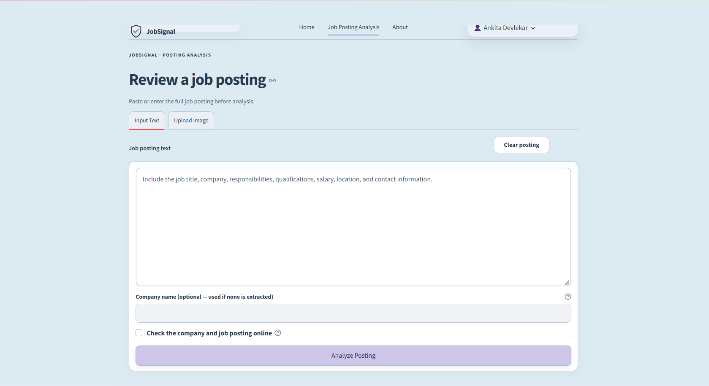

# Job Signal

## A. Project title and introduction

**Academic project title:** Fake Job Detection Using Machine Learning and
Explainable Artificial Intelligence.

Fraudulent online job postings can mislead applicants, solicit fees, or request
personal information under false pretenses. Job Signal is a Streamlit
decision-support application for job seekers, students, recent graduates, and
other applicants who want to review a posting before taking action. It
combines a saved machine-learning prediction with separate text-based
indicators, image text extraction, and optional company and vacancy searches.

## B. Project objectives

- Identify postings that the saved machine-learning model classifies as
  potentially fraudulent.
- Analyze pasted job-posting text and extract commonly used job fields.
- Support image-based analysis by extracting text from an uploaded posting.
- Present text evidence and rule-based explanations alongside the model result.
  These rules do not explain the Linear SVM's internal reasoning or change its
  prediction.
- Offer optional searches for company and vacancy information.
- Show warning indicators and safety recommendations without presenting them
  as proof or a guarantee.

## C. Application workflow

1. The user signs in and enters a posting as text, or selects an image for
  analysis.
2. For an image, PaddleOCR extracts text locally. The user can review and edit
  the extracted text before submitting it.
3. Job Signal extracts job fields, checks whether there is enough information,
  and transforms the posting with the saved preprocessing pipeline.
4. When the posting has sufficient information, the saved Linear SVM produces
  a prediction. The app does not train the model during a run.
5. Separate text rules identify warning and positive patterns and show
  relevant evidence. They are explanatory signals, not an explanation of the
  model's internal reasoning.
6. A project-defined risk indicator summarizes rule-matched warnings; it is
  not a probability of fraud.
7. If the user opts in and configures Tavily, the app searches for company and
  vacancy evidence. Results may be incomplete or unavailable and do not
  establish whether a job is genuine.
8. The results page presents the model assessment, completeness feedback,
  text-based warnings and positive signs, optional search evidence, and
  suggested safety actions as distinct signals.

## D. Main features

- **Job posting analysis:** paste a posting or submit text extracted from an
  image; common fields and posting completeness are assessed.
- **Machine-learning prediction:** use the saved Linear SVM and matching
  preprocessing artifacts.
- **Explainability features:** rule-based explanations show matched text,
  warning reasons, positive indicators, and suggested actions. These do not
  explain the model's internal decision process.
- **OCR text extraction:** process PNG or JPEG images locally with PaddleOCR
  and review the extracted text before analysis.
- **Risk assessment:** display rule-based warning indicators and a
  project-defined risk band, not a calibrated fraud probability.
- **Company and vacancy verification:** optionally search for employer and
  vacancy evidence through Tavily and show sources for review.
- **Safety recommendations:** suggest steps such as independently confirming
  the employer and avoiding suspicious payment requests.
- **User authentication:** register and sign in with account and session data
  stored in a local SQLite database.

## Application Screenshots

### Home Page

**Home page overview** — the screening workspace and its main analysis entry point.


**Recent analyses and workflow** — the session history area and the four-step workflow.


**Separate analysis signals and project information** — model assessment, completeness, warning signals, and the About section.


### Job Posting Analysis

**Text-entry form** — enter a job posting and optionally enable online checks.



**Posting ready for analysis** — an example posting with the online-check option selected.


**Assessment and positive signs** — the model assessment, posting completeness, warning level, and text-based positive indicators.


**Online verification results** — separate company and vacancy search outcomes.


**Recommendations and conclusion** — suggested next steps and the overall analysis summary.


### Authentication

**Sign-in page** — the account sign-in form and JobSignal introduction.


**Registration page** — the account creation form.


## E. Technology stack

Direct application and test dependencies are listed in
[`requirements.txt`](requirements.txt):

- Python 3.13 was used for local testing.
- Streamlit provides the interface.
- NumPy, pandas, SciPy, scikit-learn, and Joblib support feature processing and
  loading the saved model.
- PaddleOCR and PaddlePaddle provide CPU-based image text extraction.
- Pillow validates and decodes uploaded images.
- Requests, Beautiful Soup, and lxml support Tavily requests and public-page
  inspection.
- python-dotenv loads an optional local environment file.
- Tavily Search API is an optional external service called through Requests;
  there is no separate Tavily client package.
- Python's standard-library SQLite support stores local account and session
  data.

## F. Repository structure

```text
.
├── .gitignore
├── README.md
├── requirements.txt       # Runtime and test dependencies
├── env.example            # Blank optional Tavily-key template
├── app/                   # Streamlit UI, local authentication, and XAI rules
│   ├── app.py
│   ├── auth.py
│   └── xai.py
├── src/                   # Extraction, prediction, preprocessing, OCR, verification
│   ├── job_extraction.py
│   ├── model.py
│   ├── ocr.py
│   ├── preprocessing.py
│   ├── risk_engine.py
│   └── web_verification.py
├── models/                # Saved model and engineered-feature artifacts
│   ├── best_model.pkl
│   ├── engineered_features.pkl
│   └── engineered_imputer.pkl
├── data/processed/        # Inference preprocessors and one-row test fixtures
│   ├── binary_features.pkl
│   ├── categorical_features.pkl
│   ├── categorical_pipeline.pkl
│   ├── numerical_features.pkl
│   ├── numerical_pipeline.pkl
│   ├── text_features.pkl
│   ├── tfidf_vectorizer.pkl
│   ├── X_test_cleaned.pkl
│   └── X_test_final.pkl
├── results/model_results/ # Historical comparison metrics shown in the app
│   └── model_comparison.csv
└── tests/                 # Application and OCR test suite
    ├── test_job_analysis.py
    └── test_ocr.py
```

## G. Installation and setup

In PowerShell, clone the repository and enter its directory. Replace the
placeholders with the repository URL and directory name supplied when it is
published:

```powershell
git clone <repository-url>
cd <repository-directory>
py -3.13 -m venv .venv
.\.venv\Scripts\Activate.ps1
python -m pip install --upgrade pip
python -m pip install -r requirements.txt
```

Python 3.13 was used for local testing; a broader supported Python range has
not been declared. PaddleOCR and PaddlePaddle can make installation large.
First OCR use may download model files and needs network access and writable
cache storage. Configure Tavily only if online verification is needed, then
start the application from the repository root:

```powershell
Copy-Item .\env.example .\.env
streamlit run app/app.py
```

The app creates the local SQLite account database as needed. Do not commit the
generated database. Hosted deployments need persistent storage if account
data must survive restarts or redeployments.

## H. Tavily API configuration

Tavily is optional. The app reads `TAVILY_API_KEY` from the process environment
or local `.env`. `env.example` is only a blank template; users must provide
their own key in `.env` or the process environment. Keep `.env` private and do
not commit it. When online verification is enabled, relevant job-posting
information may be sent to Tavily to search for company and vacancy evidence.
Search results can be incomplete or unavailable and are not proof of
legitimacy or fraud.

## I. Model and preprocessing artifacts

The application expects these saved artifacts at the paths shown:

| Path | Purpose |
|---|---|
| `models/best_model.pkl` | Saved binary Linear SVM used for inference |
| `models/engineered_features.pkl` | Engineered feature names and order |
| `models/engineered_imputer.pkl` | Fitted engineered-feature imputer |
| `data/processed/tfidf_vectorizer.pkl` | Fitted text vectorizer |
| `data/processed/categorical_pipeline.pkl` | Fitted categorical transformer |
| `data/processed/numerical_pipeline.pkl` | Fitted numerical transformer |
| `data/processed/binary_features.pkl` | Binary feature names |
| `data/processed/categorical_features.pkl` | Categorical feature names |
| `data/processed/numerical_features.pkl` | Numerical feature names |
| `data/processed/text_features.pkl` | Text feature names |
| `results/model_results/model_comparison.csv` | Historical comparison metrics displayed in the About page |

The saved model and preprocessing files must come from the same compatible
model build. The application loads these existing artifacts for inference; it
does not retrain the model each time it runs. The decision margin is not a
calibrated probability. The comparison CSV contains historical evaluation
information displayed by the application, not a live model evaluation. The
one-row `X_test_cleaned.pkl` and `X_test_final.pkl` fixtures are used only by
the preprocessing compatibility test and are not loaded during normal app
inference.

## J. Testing

Run the application tests from this directory:

```powershell
python -m unittest discover -s tests -v
```

The tests cover posting extraction and analysis, model/preprocessing
compatibility, rule explanations and risk indicators, authentication,
verification logic, Streamlit flows, and OCR input validation. OCR tests mock
the engine where appropriate and do not require model downloads.

## K. Limitations and responsible use

- A machine-learning prediction can be wrong. It is not proof that a job is
  genuine or fraudulent, and the model margin is not a calibrated probability.
- Rule-based indicators explain text patterns; they do not establish intent or
  explain the Linear SVM's internal decision.
- Web search evidence may be incomplete, unavailable, or unrelated. Tavily
  verification requires an API key and internet access and does not guarantee
  that a company or vacancy is genuine.
- OCR quality depends on image clarity. Review extracted text before analysis.
- Independently verify employers and vacancies through trusted channels. Never
  pay recruitment fees or share sensitive information before verification.
- Account data is stored in a local SQLite file. Hosted Streamlit deployments
  may not preserve it across restarts unless persistent storage is configured.
- PaddleOCR and PaddlePaddle can require substantial installation resources;
  OCR model files may be downloaded on first use.

## L. Future improvements

Possible future work includes validation on new, well-documented data; review
of prediction calibration and monitoring; additional synthetic and
privacy-reviewed test fixtures; durable account storage for hosted deployments;
and evaluation of OCR across more image qualities and languages. These are
potential improvements, not features currently provided by the application.

